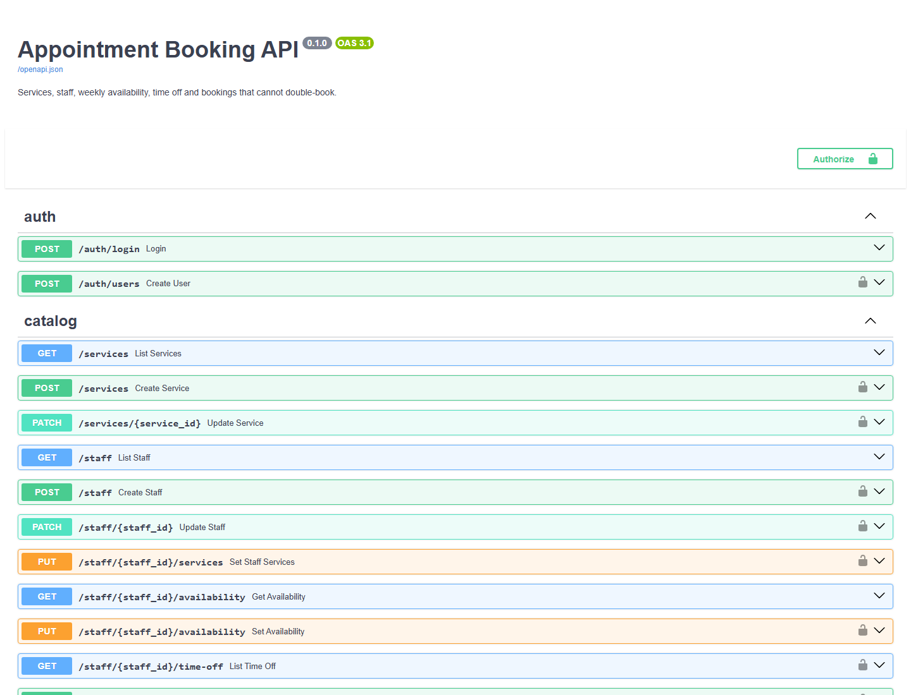
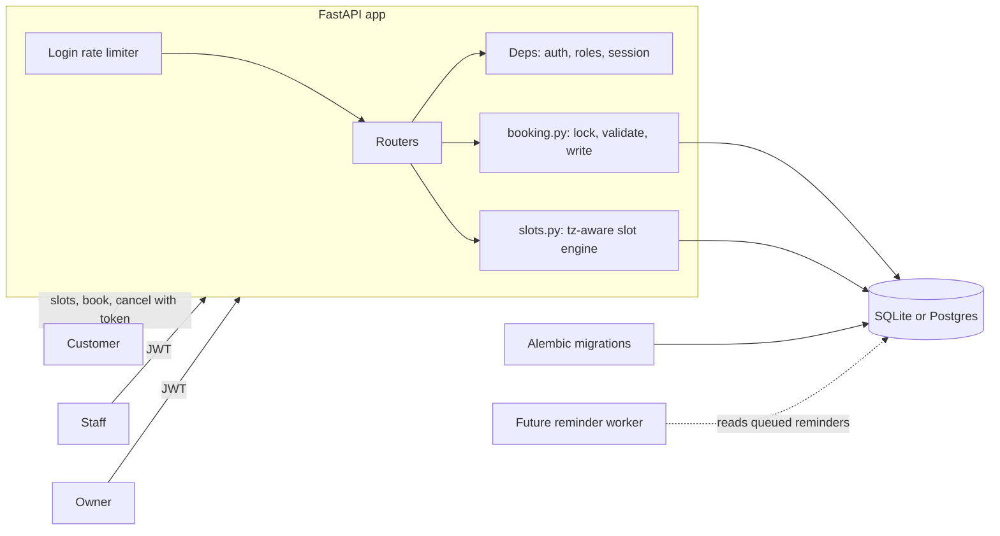

# appointment-booking-api

[](https://github.com/chasebuilds/appointment-booking-api/actions/workflows/ci.yml)

A FastAPI backend for a small business that takes appointments: services, staff, weekly
availability, time off, and bookings that cannot double-book. Customers book without an
account. Owners and staff log in with JWT roles.

Built by Chase Builds. Python 3.11+, SQLModel/SQLAlchemy, Alembic, SQLite for development,
Postgres in Docker.



## What it does

- **Services and staff.** Owners define services (name, duration, price) and staff, and say
  which staff offer which services.
- **Weekly availability.** Each staff member has local wall-clock windows per weekday, in
  their own timezone.
- **Time off.** Blocks slots without touching the weekly pattern.
- **Slots.** `GET /slots` returns open start times in UTC plus the staff-local time.
- **Bookings.** Public `POST /bookings`. Two people cannot hold overlapping times with the
  same staff member (see below).
- **Cancellation.** Customers cancel with the token returned when they booked. Staff and
  owners cancel with their login.
- **Reminders.** Booking creates `24h` and `1h` reminder records (`queued`). Cancelling flips
  them to `cancelled`. Nothing sends email: a worker would read `GET /reminders`.
- **Auth.** JWT (HS256), roles `owner` and `staff`. Staff manage only their own availability
  and time off and see only their own bookings. Login is rate limited.

## Architecture



## How double-booking is prevented

Writes go through one function, `app/booking.py`. It uses three layers:

1. A per-staff lock in the process. This is what protects SQLite and single-node runs.
2. `SELECT ... FOR UPDATE` on the staff row. Postgres honors it, so several workers
   serialize per staff member. SQLite ignores it.
3. A partial unique index on `(staff_id, start_utc)` for confirmed bookings, as a last
   backstop for identical start times.

Inside the lock the function checks that the start is on the staff member's generated slot
grid, then checks for any overlapping confirmed booking or time off. Tests fire 24 threads at
one slot (service level and over HTTP) and at overlapping starts (09:00 vs 09:15). Exactly one
request wins each time.

## Timezones

- Availability is stored as local wall-clock times for the staff member's IANA zone.
- Each window is converted to UTC for its own date, then walked in real elapsed time, so
  a 00:00 to 08:00 window has 14 half-hour slots on spring-forward day, 18 on fall-back day
  and 16 otherwise (America/New_York, tested).
- A wall time inside the spring-forward gap resolves with `fold=0` (PEP 495). An ambiguous
  time on fall-back resolves to its first occurrence.
- All timestamps are stored and returned in UTC. Requests must carry a UTC offset; naive
  datetimes get a 422.

## Run it

With Docker (Postgres, migrations, API):

```bash
docker compose up --build
# API on http://localhost:8000, docs on http://localhost:8000/docs
```

Change `SECRET_KEY`, `OWNER_EMAIL` and `OWNER_PASSWORD` for anything beyond a local try-out.

Without Docker (SQLite):

```bash
python -m venv .venv && . .venv/bin/activate      # Windows: .venv\Scripts\activate
pip install -e ".[dev]"
export OWNER_EMAIL=owner@example.com OWNER_PASSWORD="change this password"
alembic upgrade head
uvicorn app.main:app --reload
```

Settings come from environment variables or `.env`: `DATABASE_URL`, `SECRET_KEY`,
`TOKEN_MINUTES`, `DEFAULT_TIMEZONE`, `SLOT_STEP_MINUTES` (15), `MIN_NOTICE_MINUTES` (60),
`MAX_DAYS_AHEAD` (90), `LOGIN_RATE_LIMIT` (5), `LOGIN_RATE_WINDOW_SECONDS` (60).

## Example calls

```bash
B=http://localhost:8000
J='content-type: application/json'

# log in as the owner
TOKEN=$(curl -s -X POST $B/auth/login -H "$J" \
  -d '{"email":"owner@example.com","password":"change this password"}' | jq -r .access_token)
H="authorization: Bearer $TOKEN"

# one service, one staff member, link them, set weekly hours (Monday = 0)
curl -s -X POST $B/services -H "$H" -H "$J" -d '{"name":"Haircut","duration_minutes":30,"price_cents":3500}'
curl -s -X POST $B/staff -H "$H" -H "$J" -d '{"name":"Alice","timezone":"America/New_York"}'
curl -s -X PUT  $B/staff/1/services -H "$H" -H "$J" -d '{"service_ids":[1]}'
curl -s -X PUT  $B/staff/1/availability -H "$H" -H "$J" \
  -d '{"windows":[{"weekday":0,"start_time":"09:00","end_time":"12:00"}]}'

# block a morning
curl -s -X POST $B/staff/1/time-off -H "$H" -H "$J" \
  -d '{"start":"2027-01-04T09:00:00-05:00","end":"2027-01-04T10:00:00-05:00","reason":"dentist"}'

# public: open slots, then book one
curl -s "$B/slots?service_id=1&date_from=2027-01-04&date_to=2027-01-10"
curl -s -X POST $B/bookings -H "$J" -d '{"service_id":1,"staff_id":1,
  "start":"2027-01-04T10:00:00-05:00","customer_name":"Sam Rivera","customer_email":"sam@example.com"}'
# -> 201 with "cancel_token". The same slot again -> 409 {"detail":"That slot is no longer available"}

# customer cancels with the token; staff or owner use /staff-cancel with a JWT
curl -s -X POST "$B/bookings/1/cancel?token=<cancel_token>"
curl -s -X POST $B/bookings/1/staff-cancel -H "$H"

# owner: create a staff login, list queued reminders
curl -s -X POST $B/auth/users -H "$H" -H "$J" \
  -d '{"email":"alice@example.com","password":"a long password 1","role":"staff","staff_id":1}'
curl -s "$B/reminders?status=queued" -H "$H"
```

## Endpoints

| Method | Path | Who |
|---|---|---|
| POST | `/auth/login` | public, rate limited |
| POST | `/auth/users` | owner |
| GET | `/services`, `/staff`, `/slots`, `/staff/{id}/availability` | public |
| POST, PATCH | `/services`, `/staff` | owner |
| PUT | `/staff/{id}/services` | owner |
| PUT | `/staff/{id}/availability` | owner, or that staff member |
| GET, POST, DELETE | `/staff/{id}/time-off` | owner, or that staff member |
| POST | `/bookings` | public |
| POST | `/bookings/{id}/cancel?token=` | customer with token |
| GET | `/bookings` | owner (all), staff (own) |
| POST | `/bookings/{id}/staff-cancel` | owner, staff (own) |
| GET | `/reminders` | owner |
| GET | `/health` | public |

Full schema at `/docs` and `/openapi.json`.

## Tests and checks

```bash
ruff check app tests && ruff format --check app tests
mypy                      # strict
pytest                    # fails under 90% coverage
```

48 tests, 98.96% line coverage at the time of writing. They cover the API flow and roles,
validation, login rate limiting (with a fake clock), migrations up and down, DST
and odd-offset zones, and the concurrency cases above. CI runs ruff, mypy strict and pytest
on Python 3.11 and 3.12, then builds the image, starts the compose stack with Postgres and
hits `/health`.

## Limitations

- **One timezone per staff member, one business.** No per-location rules, no customer
  timezone preference (customers send an offset, responses are UTC plus staff-local time).
- **Reminders are records only.** No email or SMS sender is included.
- **Login rate limiter is in memory.** It is per process. Behind several workers or nodes,
  use a proxy limit or Redis. It counts attempts by IP and by email, so a determined attacker
  can lock out a known email for a minute at a time.
- **Customers have no accounts.** A leaked cancel token cancels that booking. There is no
  reschedule endpoint; cancel and rebook.
- **Time off does not cancel existing bookings.** It only blocks new ones.
- **Slots follow a fixed grid** (`SLOT_STEP_MINUTES` from window start). No buffers between
  appointments, no multi-staff bookings, no payments.
- **Tests run on SQLite.** The Postgres path (migrations, `FOR UPDATE`, the partial index)
  is exercised by the CI Docker job, not the pytest suite.
- **No token refresh or revocation.** Tokens are valid until they expire (60 minutes by
  default); deactivating a user blocks them on the next request.

## License

MIT, see [LICENSE](LICENSE).
